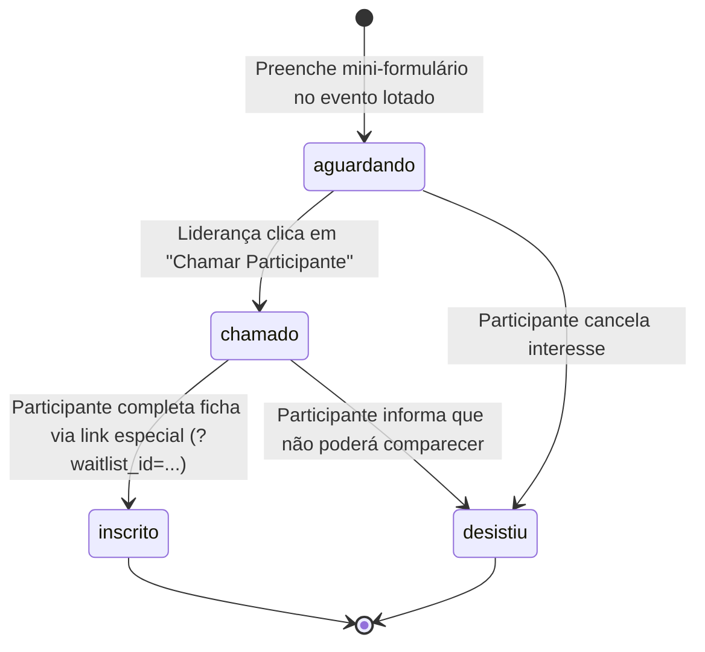

# Lista de Espera Automática de Eventos (Waitlist)

Este documento descreve a arquitetura, o modelo de dados, as regras de segurança e o fluxo operacional da funcionalidade de **Lista de Espera Automática para Eventos/Retiros** (Issue #81).

---

## 1. Visão Geral e Objetivo
Quando um encontro ou retiro atinge a sua capacidade máxima (`max_participants`), o formulário de inscrição é bloqueado (`closedReason === 'full'`). Em vez de simplesmente exibir uma mensagem estéril de recusa, a aplicação apresenta uma experiência acolhedora de entrada na **Lista de Espera**:
1. O participante preenche um mini-formulário limpo e acolhedor (`EventWaitlistForm`).
2. Se o participante indicar que já comprou passagem, ele recebe uma mensagem imediata de prioridade e é destacado na gestão.
3. A liderança (presbíteros, diáconos e organizadores) gerencia os inscritos em ordem cronológica de chegada na aba **Lista de Espera** do evento.
4. Quando uma vaga é liberada, a liderança aciona a ação **"Chamar Participante"**, que gera um código exclusivo, link direto com bypass de capacidade e botão de contato imediato via WhatsApp.
5. Ao concluir a inscrição através do link especial (`?waitlist_id=...`), o participante tem sua vaga garantida e o registro na fila é automaticamente atualizado para o status `inscrito`.

---

## 2. Modelo de Dados (`public.event_waitlist`)

A tabela `event_waitlist` armazena os registros de interessados aguardando vaga:

| Coluna | Tipo | Restrições | Descrição |
| :--- | :--- | :--- | :--- |
| `id` | `uuid` | `PRIMARY KEY DEFAULT gen_random_uuid()` | Identificador único |
| `retreat_id` | `uuid` | `REFERENCES public.retreats(id) ON DELETE CASCADE NOT NULL` | Vínculo com o evento |
| `full_name` | `text` | `NOT NULL` | Nome completo do interessado |
| `cpf` | `text` | `NULLABLE` | CPF para conferência administrativa |
| `phone` | `text` | `NOT NULL` | Telefone/WhatsApp com máscara |
| `email` | `text` | `NOT NULL` | E-mail para contato |
| `city_state` | `text` | `NULLABLE` | Cidade / Estado de origem |
| `travel_mode` | `text` | `NULLABLE` | "Já comprei passagem", "Carro próprio", "Carona", "A definir" |
| `notes` | `text` | `NULLABLE` | Observações adicionais do interessado |
| `status` | `text` | `DEFAULT 'aguardando' CHECK (status IN ('aguardando', 'chamado', 'inscrito', 'desistiu'))` | Estado no ciclo de vida |
| `created_at` | `timestamptz` | `DEFAULT now()` | Timestamp exato de entrada para ordenação FIFO |

### Índices de Performance
- `idx_event_waitlist_retreat_id`: Otimiza consultas filtradas pelo retiro.
- `idx_event_waitlist_created_at`: Garante ordenação cronológica estrita eficiente (`created_at ASC`).
- `idx_event_waitlist_status`: Acelera contadores e filtros por status (`aguardando`, `chamado`, etc.).

---

## 3. Políticas de Segurança (Row Level Security - RLS)

A tabela opera com segurança a nível de linha habilitada (`ROW LEVEL SECURITY`):
- **`INSERT` (Público / Autenticado):** Qualquer pessoa (inclusive visitantes não autenticados que acessam a ficha de inscrição) pode submeter seus dados para a lista de espera de um evento.
- **`SELECT` (Liderança e Desenvolvedores):** Apenas usuários autenticados com papéis de liderança (`profiles.is_dev = true`, `is_presbyter = true`, `is_deacon = true` ou líderes de Grupo Caseiro na tabela `home_groups`) podem visualizar os registros e métricas.
- **`UPDATE` (Liderança e Desenvolvedores):** A liderança pode alterar o status do participante (`chamado`, `inscrito`, `desistiu`) ou atualizar anotações.
- **`DELETE` (Liderança e Desenvolvedores):** Exclusão restrita à administração para remoção de duplicatas ou testes.

---

## 4. Ciclo de Vida do Participante na Fila

1. **`aguardando`:** Registro inicial. O participante aguarda liberação de vagas na ordem cronológica de entrada.
2. **`chamado`:** A liderança notificou o participante de que surgiu uma vaga, gerando um link e código exclusivo de liberação.
3. **`inscrito`:** O participante acessou o link gerado, preencheu a ficha e confirmou sua inscrição. O sistema atualiza o status automaticamente via ID de rastreamento.
4. **`desistiu`:** Marcado manualmente pela liderança caso o participante não responda no prazo ou decline a vaga.

---

## 5. Experiência do Participante (Frontend)

### Mini-Formulário de Inscrição (`EventWaitlistForm.tsx`)
- Renderizado em `src/pages/FormResponder.tsx` quando a capacidade máxima do evento é atingida (`closedReason === 'full'`).
- Disponível como modal via `EventWaitlistDialog.tsx` em `src/pages/Events.tsx` ao clicar em "Entrar na Lista de Espera".
- **Pré-preenchimento:** Se o irmão estiver autenticado no portal, nome e e-mail são preenchidos automaticamente.
- **Destaque de Passagem:** Caso o participante selecione "Já comprei passagem", uma mensagem explicativa em destaque informa que sua prioridade será avaliada com carinho pelos organizadores.
- **Acessibilidade:** Desenvolvido com `react-hook-form` + `zod`, mobile-first (largura mínima de 320px sem overflow) e alvos de toque mínimos de 44x44px.

---

## 6. Painel de Gestão da Liderança (`EventWaitlistTab.tsx`)

Acessível na rota `/manage-events/:eventId` através da aba **"Lista de Espera"**:
1. **Contador em Tempo Real:** O título da aba exibe a quantidade atual de participantes no status `aguardando` (ex: `Lista de Espera (4)`).
2. **Quatro Cartões de Métricas (KPIs):**
   - **Total na Lista:** Quantidade total histórica de registros.
   - **Aguardando Vaga:** Participantes na fila esperando convocação.
   - **Chamados:** Participantes contatados pela liderança aguardando preenchimento.
   - **Com Passagem Comprada:** Casos com prioridade logística de deslocamento.
3. **Ordenação Cronológica Estrita (FIFO):**
   - A listagem exibe o número de posição na fila (`#1`, `#2`, `#3`...) garantindo transparência e ordem de chegada.
4. **Badges de Destaque Visual:**
   - Participantes com "Já comprei passagem" exibem badge púrpura de alto contraste (`badgePriority`), em conformidade com WCAG AAA.
5. **Ação "Chamar Participante":**
   - Modal interativo que altera o status para `chamado`.
   - Gera um código exclusivo (ex: `VAGA-AB12`).
   - Gera a URL direta com parâmetro de liberação (`/forms/:formId?waitlist_id=:id&convite=VAGA-AB12`).
   - Botão para envio direto no WhatsApp com mensagem padrão acolhedora pronta e botão de cópia de link para a área de transferência.

---

## 7. Mecanismo de Bypass de Capacidade

Em `src/pages/FormResponder.tsx`, a verificação de lotação consulta o banco para conferir se `count >= retreat.max_participants`. No entanto, se o participante acessar a URL contendo parâmetros autorizadores:
- `?waitlist_id=<UUID>`
- `?cupom=<CODIGO>`
- `?convite=<CODIGO>`

O formulário ignora o bloqueio de lotação, permitindo que o participante convocado preencha e conclua sua inscrição normalmente. No momento do salvamento bem-sucedido da inscrição em `registrations`, o sistema executa um `UPDATE` na tabela `event_waitlist` mudando o status daquele `waitlist_id` para `'inscrito'`.
